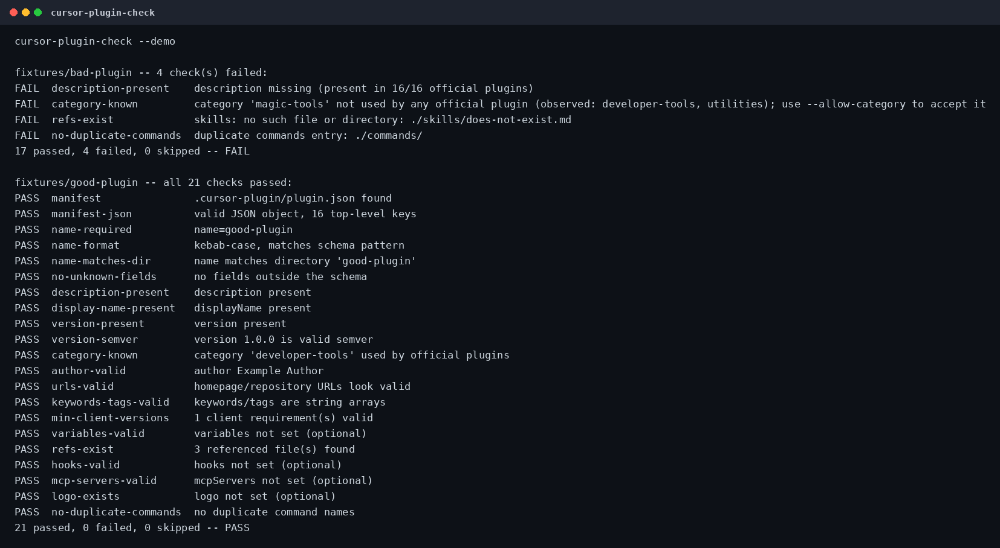

# cursor-plugin-check



**Catch a broken Cursor plugin manifest in 0.045 seconds — before you publish it and find out from your users.**
`--demo` runs both bundled fixtures (one broken, one fixed) in a median of **0.045 s** (7 runs, 0.043–0.062 s, measured 2026-11-24). Stdlib only, no install, no network.

## Why now

Cursor plugins are the format of the week: [cursor/plugins](https://github.com/cursor/plugins) hit **#5 on GitHub Trending (daily) on 2026-11-24 with 18,897 stars, +397 that day and +727 over the past 7 days** (github.com/trending, read 2026-11-24 14:07 CST; cross-checked on Trendoday, same +397/day). The official repo ships a `create-plugin` scaffolder and `schemas/plugin.schema.json` — but no standalone checker you can run offline or gate CI on. This tool is that checker: the `cargo check` for `plugin.json` + directory structure, built the same day the format trended.

Every rule in it is grounded in the live schema (`schemas/plugin.schema.json`, fetched 2026-11-24) and in the 16 official plugins sampled the same day: the schema requires only `name`, forbids unknown fields, and pins the kebab-case name pattern; all 16 official plugins also ship `description`, `version`, and `displayName`, use `name` == directory name, and use category `developer-tools` (15) or `utilities` (1). This checker enforces the schema and those conventions — nothing invented.

## Quick start (30 seconds, zero setup)

```bash
git clone https://github.com/Mahgal/cursor-plugin-check.git
cd cursor-plugin-check
python3 cursor_plugin_check.py --demo     # broken fixture FAILs, fixed fixture PASSes
python3 cursor_plugin_check.py /path/to/your-plugin
```

Python 3.8+. No dependencies. No network — the check runs entirely offline against your plugin directory.

## What it shows

Real output of `python3 cursor_plugin_check.py --demo` (captured verbatim to `demo.txt`; re-runs reproduce it byte-for-byte, sha256 `3085e6525c45788795056d9681ebf842437e9b33afcac50a112d4e8d24fa4170`):

```text
cursor-plugin-check --demo

fixtures/bad-plugin -- 4 check(s) failed:
FAIL  description-present    description missing (present in 16/16 official plugins)
FAIL  category-known         category 'magic-tools' not used by any official plugin (observed: developer-tools, utilities); use --allow-category to accept it
FAIL  refs-exist             skills: no such file or directory: ./skills/does-not-exist.md
FAIL  no-duplicate-commands  duplicate commands entry: ./commands/
17 passed, 4 failed, 0 skipped -- FAIL

fixtures/good-plugin -- all 21 checks passed:
PASS  manifest               .cursor-plugin/plugin.json found
PASS  manifest-json          valid JSON object, 16 top-level keys
PASS  name-required          name=good-plugin
PASS  name-format            kebab-case, matches schema pattern
PASS  name-matches-dir       name matches directory 'good-plugin'
PASS  no-unknown-fields      no fields outside the schema
PASS  description-present    description present
PASS  display-name-present   displayName present
PASS  version-present        version present
PASS  version-semver         version 1.0.0 is valid semver
PASS  category-known         category 'developer-tools' used by official plugins
PASS  author-valid           author Example Author
PASS  urls-valid             homepage/repository URLs look valid
PASS  keywords-tags-valid    keywords/tags are string arrays
PASS  min-client-versions    1 client requirement(s) valid
PASS  variables-valid        variables not set (optional)
PASS  refs-exist             3 referenced file(s) found
PASS  hooks-valid            hooks not set (optional)
PASS  mcp-servers-valid      mcpServers not set (optional)
PASS  logo-exists            logo not set (optional)
PASS  no-duplicate-commands  no duplicate command names
21 passed, 0 failed, 0 skipped -- PASS
```

One screen: the broken fixture fails 4 checks (missing `description`, an unknown category, a `skills` entry pointing at a file that does not exist, a duplicated `commands` entry) and the fixed fixture passes all 21. Run the checker on a plugin directory directly for the full per-check table:

```bash
$ python3 cursor_plugin_check.py fixtures/bad-plugin
cursor-plugin-check  fixtures/bad-plugin
------------------------------------------------------------------------
PASS  manifest               .cursor-plugin/plugin.json found
...
FAIL  description-present    description missing (present in 16/16 official plugins)
...
17 passed, 4 failed, 0 skipped -- FAIL
```

## What it checks (21 checks)

| Group | Checks |
| --- | --- |
| **schema** — from `schemas/plugin.schema.json` | manifest exists; valid JSON object; `name` present (the schema's only required field); `name` matches `^[a-z0-9]([a-z0-9.-]*[a-z0-9])?$`; no unknown top-level fields (`additionalProperties: false`); `version` is strict semver; `author` object shape; `homepage`/`repository` are http(s) URLs; `keywords`/`tags` are string arrays; `minClientVersions` values are semver or `"never"`; `variables.type` is `"object"`; `hooks` / `mcpServers` types |
| **policy** — from the 16 official plugins | `description`, `displayName`, `version` present; `name` == directory name; `category` is one observed in official plugins (`developer-tools`, `utilities` — extend with `--allow-category`); every `commands` / `agents` / `skills` / `rules` entry (directory, file, or glob) resolves to at least one real file; `hooks` / `mcpServers` / `logo` file paths exist; no duplicate command entries, files, or names |

Exit codes: `0` all checks pass; `1` at least one FAIL (by design — a failing plugin is a finding, not a crash); `2` usage error (not a directory, unknown option).

## CI gate

```yaml
- name: Validate Cursor plugin
  run: python3 cursor_plugin_check.py .
```

## Options

| Flag | What it does |
| --- | --- |
| `<plugin-dir>` | Check that plugin directory (exit 0/1) |
| `--demo` | Check the bundled bad + good fixtures (always exit 0) |
| `--allow-category NAME` | Accept an extra category value (repeatable) |
| `--version`, `--help` | Print version / usage |

## Tests

21 stdlib-unittest tests, no pytest needed:

```bash
python3 -m unittest discover -s tests -v
```

They cover both fixtures end to end (good → exit 0 with 21/21 PASS, bad → exit 1 with 4 FAILs), `--demo` byte-determinism across runs, missing manifest, broken JSON, non-object JSON, missing `name`/`description`, unknown fields, bad name pattern, name ≠ directory, non-semver version, unknown category (rejected, then accepted via `--allow-category`), dangling skill references, glob with no match, duplicate command entries and duplicate command names, missing hooks file, `minClientVersions` `"never"` vs invalid, and a good plugin with every optional field set.

## What it is not

- Not a plugin scaffolder — `create-plugin` in the official repo does that; this validates what it (or you) produced.
- Not a Cursor replacement — it cannot install or load a plugin, only check the manifest and files Cursor will read.
- Not a JSON Schema validator — it implements the schema's rules plus the official plugins' conventions by hand, so it stays stdlib-only and offline.

## License

MIT — see [LICENSE](LICENSE).
